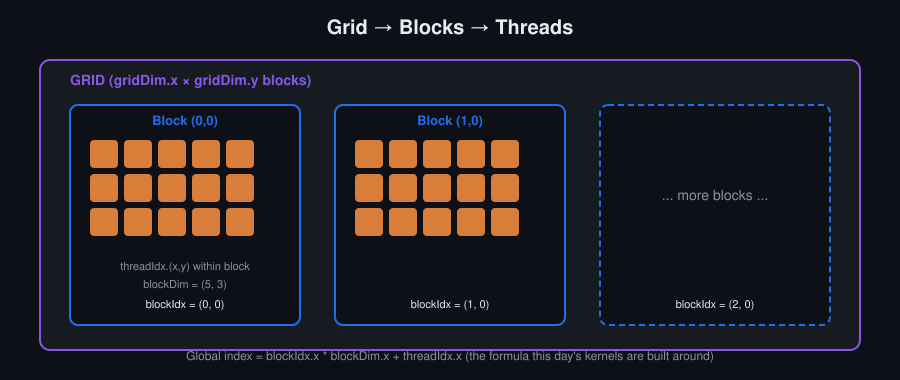

# Օր 2. Thread-երի հիերարխիան, ինդեքսավորումը և launch configuration-ը

## Նպատակներ
- Բաժանել աշխատանքը thread-երի, block-երի և grid-ի միջև՝ 1D և 2D տվյալների համար
- Գրել global index-ի բանաձևը և նկարագրել, թե ինչու այն ունի հենց այդ տեսքը
- Տարբերել coalesced և uncoalesced ինդեքսավորումը և ինդեքսները հաշվել այնպես, որ warp-ի thread-երը դիմեն հաջորդական հասցեների
- Ընտրել block size և ստուգել ընտրությունը `cudaOccupancyMaxActiveBlocksPerMultiprocessor`-ով
- Գրել grid-stride loop, որը ճիշտ է աշխատում մուտքի ցանկացած չափի դեպքում՝ նույն launch configuration-ով

## Հիմնական հասկացություններ
- Thread, block, grid՝ կառուցվածքը և համարակալումը
- Launch configuration և kernel-ի կանչ
- Kernel-ի պարամետրերը՝ միայն արժեքով, առանց հղումների
- Kernel-ի գործարկում kernel-ից (Dynamic Parallelism)
- Thread-երի 1D և 2D ինդեքսավորում
- Memory coalescing՝ որպես ինդեքսի բանաձևի հետևանք
- Occupancy և block size-ի ընտրություն (առաջին ծանոթություն, hardware-ի պատճառները՝ Օր 3-ում և Օր 6-ում)
- Grid-stride loop

## Սահմանումներ
**Thread** — Կատարման ամենափոքր միավորը։ Block-ի ներսում thread-ի դիրքը տալիս է `threadIdx`-ը, grid-ի ներսում՝ `threadIdx`-ի, `blockIdx`-ի և `blockDim`-ի համակցությունը։

**Block** — Thread-երի խումբ (առավելագույնը `maxThreadsPerBlock` thread), որոնք կատարվում են նույն SM-ի վրա և կարող են համագործակցել shared memory-ի ու `__syncthreads()`-ի միջոցով։ Kernel-ի launch-ը ստեղծում է block-երի grid։

**Grid** — Մեկ kernel-ի կանչով գործարկված block-երի ամբողջությունը՝ `<<<grid, block>>>`։

**Launch configuration** — Kernel-ի կանչի արգումենտները՝ grid-ի չափերը block-երով և block-ի չափերը thread-երով, երկուսն էլ՝ մինչև երեք չափողականությամբ, ինչպես նաև ոչ պարտադիր dynamic shared memory-ի չափը և stream-ը։

**`blockIdx`, `threadIdx`, `blockDim`, `gridDim`** — Ներկառուցված (built-in) փոփոխականներ, որոնք հասանելի են device-ի կոդում առանց հայտարարելու կամ փոխանցելու՝ block-ի ինդեքսը grid-ում, thread-ի ինդեքսը block-ում, block-ի չափերը, grid-ի չափերը։ Դրանք միայն կարդալու համար են և ունեն `uint3` տիպ (չափերը՝ `dim3`)։

Այս փոփոխականներին ձեր կոդն արժեք չի վերագրում, և դրանք հիշողության մեջ պահվող սովորական փոփոխականներ չեն։

| Փոփոխական | PTX | Ով է տալիս արժեքը |
|---|---|---|
| `threadIdx` | `%tid` | hardware-ը, երբ SM-ը ստեղծում է block-ի thread-երը |
| `blockIdx` | `%ctaid` | GPU-ի work distributor-ը, երբ block-ը վերագրում է SM-ին |
| `blockDim` | `%ntid` | host-ը՝ launch configuration-ով (`<<<grid, block>>>`) |
| `gridDim` | `%nctaid` | host-ը՝ launch configuration-ով |

Առաջին երկուսը տալիս է hardware-ը, և դրանցով են thread-երը տարբերվում իրարից։ Մյուս երկուսը launch-ի պարամետրեր են և նույնն են grid-ի բոլոր thread-երի համար։ Դրանցից որևէ մեկը կարդալու համար global memory-ին դիմել պետք չէ։ Օր 1-ի օրինակում հետևյալ PTX-ը

```ptx
mov.u32  %r3, %ntid.x;     // blockDim.x
mov.u32  %r4, %ctaid.x;    // blockIdx.x
mov.u32  %r5, %tid.x;      // threadIdx.x
```

կոմպիլացվում է այսպիսի SASS-ի, որտեղ `threadIdx`-ը և `blockIdx`-ը կարդացվում են special register-ներից, իսկ `blockDim`-ը՝ ուղիղ constant bank-ից.

```sass
S2R  R6, SR_CTAID.X ;
S2R  R3, SR_TID.X ;
IMAD R6, R6, c[0x0][0x0], R3 ;   // c[0x0][0x0]-ն blockDim.x-ն է
```

**Resident block-եր** — Մեկ SM-ին միաժամանակ վերագրված block-երը։ Դրանց քանակը չորս մեծություններից ամենափոքրն է՝ մեկ SM-ում block-երի hardware-ային սահմանը, մեկ SM-ում thread-երի առավելագույն քանակը՝ բաժանած block size-ի, մեկ SM-ի ռեգիստրների քանակը՝ բաժանած մեկ block-ի պահանջած ռեգիստրների քանակի, և մեկ SM-ի shared memory-ն՝ բաժանած մեկ block-ի պահանջած shared memory-ի։

**Occupancy** — Մեկ SM-ում resident warp-երի քանակի հարաբերությունն այն առավելագույն քանակին, որը SM-ը կարող է ունենալ։ Այն սահմանափակվում է այն ռեսուրսով, որն առաջինն է սպառվում՝ մեկ thread-ի ռեգիստրներ, մեկ block-ի shared memory կամ thread-երի քանակի սահման։ Occupancy-ն **latency hiding**-ի միջոց է, ոչ թե նպատակ։ Մոտավորապես 50 տոկոսից հետո դրա աճը հաճախ գրեթե չի արագացնում կատարումը։ Thread coarsening-ը (Օր 6) նույնիսկ դիտմամբ իջեցնում է occupancy-ն՝ ամեն thread-ին ավելի շատ աշխատանք տալով։

**`cudaOccupancyMaxActiveBlocksPerMultiprocessor`** — Runtime-ի կանչ, որը հաշվում է, թե տվյալ kernel-ի և block size-ի դեպքում քանի block կլինի resident մեկ SM-ում՝ առանց kernel-ը գործարկելու։

```c
cudaError_t cudaOccupancyMaxActiveBlocksPerMultiprocessor(
    int        *numBlocks,        // ելք՝ resident block-երի քանակը մեկ SM-ում
    const void *func,             // kernel-ի սիմվոլը
    int         blockSize,        // block-ի thread-երի քանակը, որով նախատեսում եք գործարկել
    size_t      dynamicSMemSize); // մեկ block-ի dynamic shared memory-ն բայթերով, կամ 0
```

`func`-ը kernel-ի անունն է։ C++-ում այն ավտոմատ վերածվում է ֆունկցիայի հասցեի, ուստի կանչը գրվում է այսպես՝ `cudaOccupancyMaxActiveBlocksPerMultiprocessor(&n, my_kernel, 256, 0)`։ `dynamicSMemSize`-ը launch-ի երրորդ արգումենտն է (`my_kernel<<<grid, block, smem>>>`), ոչ թե ստատիկ հայտարարված `__shared__` զանգվածների չափը։ Ստատիկ զանգվածները կոմպիլյատորն արդեն հաշվի է առել։

Արդյունքը block-երի քանակ է, ոչ թե տոկոս։ Occupancy-ն դրանից հաշվվում է այսպես.

```c
int n;
CUDA_CHECK(cudaOccupancyMaxActiveBlocksPerMultiprocessor(&n, my_kernel, blockSize, 0));

cudaDeviceProp p;
CUDA_CHECK(cudaGetDeviceProperties(&p, 0));

double occupancy = double(n * blockSize) / p.maxThreadsPerMultiProcessor;
```

Պատասխանը հաշվվում է կոմպիլացված kernel-ի ռեգիստրների քանակից և shared memory-ի պահանջից՝ համեմատելով դրանք այս device-ի սահմանների հետ։ Ոչինչ չի գործարկվում, ուստի սա residency-ի վերին սահմանն է, ոչ թե չափում։ Այն ցույց է տալիս, թե քանի block **կարող է** resident լինել, բայց ոչ թե որքան է SM-ն իրականում զբաղված եղել։ Իրական արժեքը չափում է Nsight Compute-ի `sm__warps_active.avg.pct_of_peak_sustained_active` մետրիկը։ Երկու թվերը տարբերվում են, երբ block-երն ավարտվում են տարբեր ժամանակ, կամ երբ grid-ը չափազանց փոքր է ամբողջ device-ը զբաղեցնելու համար։

Երկու հարակից ֆունկցիա.

- `cudaOccupancyMaxActiveBlocksPerMultiprocessorWithFlags` — նույն ֆունկցիան՝ flags պարամետրով։ `cudaOccupancyDefault`-ը պահպանում է սովորական վարքը, իսկ `cudaOccupancyDisableCachingOverride`-ը վերաբերում է այն platform-ներին, որտեղ global memory-ի caching-ը ազդում է occupancy-ի վրա։ Լռելյայն, եթե caching-ի պատճառով occupancy-ն զրո է ստացվում, հաշվարկը կատարվում է այնպես, կարծես caching-ն անջատված է։ Այս flag-ով ֆունկցիան այդ դեպքում վերադարձնում է 0։ CUDA-ի փաստաթղթերը այս վարքը կապում են Maxwell architecture-ի «Unified L1/Texture Cache»-ի հետ։
- `cudaOccupancyMaxPotentialBlockSize` — պատասխանում է հակառակ հարցին։ Ձեր ընտրած block size-ը գնահատելու փոխարեն այն առաջարկում է ամենաբարձր occupancy տվող block size-ը և այն ամենափոքր grid-ը, որով այդ occupancy-ն ձեռք է բերվում։ Օգտակար է որպես ելակետ, ոչ թե որպես վերջնական պատասխան։ Ամենաբարձր occupancy-ն միշտ չէ, որ տալիս է ամենաարագ կատարումը։

**Coalescing (memory coalescing)** — Երբ warp-ի 32 lane-երը դիմում են հաջորդական հասցեների, hardware-ը դրանք սպասարկում է մեկ 128-բայթանոց transaction-ով (4-բայթանոց տարրերի դեպքում)՝ մինչև 32 առանձին transaction-ի փոխարեն։ Coalescing-ը warp-ի հատկություն է, ոչ թե thread-ի։ Կարևորն այն է, թե մեկ հրամանի ընթացքում 32 lane-երը միասին ինչ հասցեների են դիմում, և ոչ թե այն, թե մեկ thread-ը ժամանակի ընթացքում որ հասցեներով է անցնում։

**Grid-stride loop** — Kernel գրելու եղանակ, որի դեպքում grid-ի չափը կախված չէ տվյալների չափից։ Ֆիքսված քանակով thread-երից ամեն մեկը ցիկլով մշակում է մի քանի տարր, և ամեն կրկնությունում ինդեքսը մեծանում է thread-երի ընդհանուր քանակով։ Ճիշտ է աշխատում մուտքի ցանկացած չափի դեպքում՝ առանց launch-ի չափերը վերահաշվելու։

## Ֆունկցիաներ

```c
// Block-ի barrier՝ ոչ մի thread չի անցնում այն, քանի դեռ block-ի բոլոր thread-երը չեն հասել
void __syncthreads(void);

// *numBlocks-ում գրում է, թե տվյալ block size-ի և dynamic shared memory-ի դեպքում
// func kernel-ից քանի block կլինի resident մեկ SM-ում
cudaError_t cudaOccupancyMaxActiveBlocksPerMultiprocessor(int *numBlocks, const void *func,
                                                          int blockSize, size_t dynamicSMemSize);

// Նույնը՝ flags պարամետրով (cudaOccupancyDefault կամ cudaOccupancyDisableCachingOverride)
cudaError_t cudaOccupancyMaxActiveBlocksPerMultiprocessorWithFlags(int *numBlocks, const void *func,
                                                                   int blockSize, size_t dynamicSMemSize,
                                                                   unsigned int flags);

// Առաջարկում է ամենաբարձր occupancy տվող block size-ը և դրա համար անհրաժեշտ ամենափոքր grid-ը
template <class T>
cudaError_t cudaOccupancyMaxPotentialBlockSize(int *minGridSize, int *blockSize, T func,
                                               size_t dynamicSMemSize = 0, int blockSizeLimit = 0);

// Kernel-ի ատրիբուտ, օրինակ՝ cudaFuncAttributePreferredSharedMemoryCarveout
// (value-ն տոկոս է 0-ից 100 կամ cudaSharedmemCarveoutDefault, MaxL1, MaxShared)
cudaError_t cudaFuncSetAttribute(const void *func, enum cudaFuncAttribute attr, int value);

// Runtime-ի սահմաններ, օրինակ՝ cudaLimitDevRuntimePendingLaunchCount
cudaError_t cudaDeviceSetLimit(enum cudaLimit limit, size_t value);

// Օր 1-ից՝ device-ի կոդից տպում է ծրագրի stdout-ում
int printf(const char *format, ...);
```

## Kernel-ի պարամետրերը
Host-ից kernel-ին տրված արգումենտները փոխանցվում են միայն արժեքով։ Launch-ի ժամանակ runtime-ը դրանք պատճենում է device-ի constant memory, և ամեն thread կարդում է այդ պատճենը։ Kernel-ը արժեք չի վերադարձնում (`void`), ուստի արդյունքը գրվում է device-ի հիշողության մեջ՝ ցուցիչի միջոցով։

Որպես պարամետր կարելի է փոխանցել.

- թվային տիպեր՝ `int`, `float`, `size_t` և այլն,
- device-ի հիշողության ցուցիչներ, օրինակ՝ `cudaMalloc`-ով ստացված `float *d_a`,
- struct-եր և class-եր արժեքով, օրինակ՝ `dim3` կամ սեփական struct։

Չի կարելի փոխանցել.

- հղումներ՝ `float &x`, `const Params &p`, `Params &&p`,
- փոփոխական քանակով արգումենտներ (`...`, `va_list`) և `std::initializer_list`։

Հղումն իրականում host-ի փոփոխականի հասցեն է, իսկ host-ի և device-ի հիշողությունները առանձին address space-եր են (Օր 1)։ nvcc 12.8-ը `T &` պարամետրի համար սխալ չի տալիս (սխալ է տալիս միայն `T &&`-ի համար), ուստի այս կանոնը պետք է պահպանել ձեռքով։ Host-ի սովորական հիշողության ցուցիչը (`malloc`-ով ստացված կամ stack-ի փոփոխականի հասցեն) նույնպես կոմպիլացվում է, բայց device-ը, ընդհանուր դեպքում, չի կարող դիմել այդ հասցեին։ Բացառությունները mapped և unified հիշողությունն են (Օր 4)։

Պարամետրերի ընդհանուր չափը սահմանափակ է՝ 32 764 բայթ Volta-ից սկսած և 4 ԿԲ ավելի հին architecture-ների վրա։

```c
struct Params { int n; float scale; };

__global__ void scale(float *data, Params p);   // ճիշտ՝ device-ի ցուցիչ և struct արժեքով
__global__ void bad1(float &x);                 // սխալ՝ հղում (nvcc-ն սխալ չի տալիս)
__global__ void bad2(const Params &p);          // սխալ՝ const հղումը նույնպես հղում է
__global__ void bad3(Params &&p);               // սխալ՝ nvcc-ն տալիս է compile error
```

### Ով է տալիս kernel-ի օգտագործած արժեքները
Kernel-ի ներսում thread-ն օգտագործում է երեք տեսակի արժեք։ Դրանք տալիս են տարբեր բաղադրիչներ և պահվում են տարբեր տեղերում.

| Արժեք | Ով է տալիս | Որտեղից է thread-ը կարդում |
|---|---|---|
| Kernel-ի արգումենտները (`float *data`, `Params p`) | host-ի կոդը։ Launch-ի ժամանակ driver-ը դրանք գրում է constant memory-ի bank 0-ում | constant bank՝ `c[0x0][0x210]` և հաջորդ հասցեները |
| `blockDim`, `gridDim` | host-ի կոդը՝ `<<<grid, block>>>`-ով։ Driver-ը դրանք գրում է նույն bank-ում | constant bank՝ `c[0x0][0x0]` (`blockDim.x`), `c[0x0][0xc]` (`gridDim.x`) |
| `blockIdx` | GPU-ի work distributor-ը, երբ block-ը վերագրում է SM-ին | SM-ի special register՝ `SR_CTAID` |
| `threadIdx` | SM-ը, երբ ստեղծում է block-ի thread-երը | SM-ի special register՝ `SR_TID` |

Արգումենտները, `blockDim`-ը և `gridDim`-ը նույնն են grid-ի բոլոր thread-երի համար, ուստի դրանք պահվում են մեկ տեղում՝ constant bank-ում։ `blockIdx`-ը և `threadIdx`-ը տարբեր են ամեն thread-ի համար, ուստի դրանք տալիս է hardware-ը special register-ների միջոցով։

Օրինակ՝ այս kernel-ը

```c
__global__ void scale(float *data, Params p)
{
    int i = blockIdx.x * blockDim.x + threadIdx.x;
    int stride = gridDim.x * blockDim.x;
    for (; i < p.n; i += stride) data[i] *= p.scale;
}
```

nvcc 12.8-ը (`-arch=sm_90`) կոմպիլացնում է SASS-ի, որտեղ այդ արժեքները կարդացվում են այսպես.

```sass
S2R    R5, SR_CTAID.X ;         // blockIdx.x   SM-ի special register
S2R    R0, SR_TID.X ;           // threadIdx.x  SM-ի special register
ULDC   UR4, c[0x0][0x0] ;       // blockDim.x   constant bank
LDC    R2, c[0x0][0xc] ;        // gridDim.x    constant bank
LDC.64 R2, c[0x0][0x210] ;      // data         արգումենտ, constant bank
ULDC   UR6, c[0x0][0x218] ;     // p.n          արգումենտ, constant bank
ULDC   UR7, c[0x0][0x21c] ;     // p.scale      արգումենտ, constant bank
```

Constant bank-ի հասցեները կախված են architecture-ից, դրանք անգիր անելու կարիք չկա։ Կարևորը բաժանումն է. ընդհանուր արժեքները գալիս են host-ից driver-ի միջոցով, իսկ ամեն thread-ի սեփական ինդեքսները՝ SM-ի hardware-ից։

## Kernel-ի գործարկում kernel-ից (Dynamic Parallelism)
Kernel-ը կարող է գործարկել այլ kernel կամ ինքն իրեն՝ նույն `<<<grid, block>>>` գրելաձևով։ Սա կոչվում է Dynamic Parallelism։ Գործարկող grid-ը կոչվում է parent, գործարկվածը՝ child։

```c
__global__ void tree(int depth)
{
    if (threadIdx.x == 0) printf("depth %d\n", depth);
    if (depth < 3 && threadIdx.x == 0)
        tree<<<1, 2>>>(depth + 1);     // kernel-ը գործարկում է ինքն իրեն
}
```



Ամեն grid-ի thread 0-ն տպում է իր տողը և գործարկում հաջորդ grid-ը։ Parent grid-ի thread-երը կարող են ավարտել իրենց կոդը child-ից առաջ, բայց grid-ը համարվում է ավարտված միայն child grid-ի ավարտից հետո (դեղին վիճակ)։ Ուստի grid-երն ավարտվում են հակառակ հերթականությամբ՝ depth 3-ից մինչև depth 0, և host-ի `cudaDeviceSynchronize()`-ը վերադառնում է միայն դրանից հետո։

Կանոնները.

- Կոմպիլացնել պետք է separate compilation ռեժիմով և device runtime գրադարանով՝ `nvcc -arch=sm_90 -rdc=true file.cu -o file -lcudadevrt`։ Առանց `-rdc=true`-ի nvcc-ն տալիս է սխալ. «kernel launch from \_\_device\_\_ or \_\_global\_\_ functions requires separate compilation mode»։ Դասընթացի `compile.sh`-ը `-rdc=true` չի փոխանցում, ուստի այս դեպքում հրամանը պետք է գրել ձեռքով։
- Kernel-ը չի կարող կանչել ինքն իրեն որպես սովորական ֆունկցիա, քանի որ `__global__` ֆունկցիաները recursion չեն աջակցում։ Recursion-ը հնարավոր է միայն նոր launch-ի միջոցով, ինչպես վերևի օրինակում։
- Parent grid-ը համարվում է ավարտված միայն այն ժամանակ, երբ ավարտվել են նրա բոլոր child grid-երը։
- Device-ի կոդում `cudaDeviceSynchronize()`-ով child grid-ի ավարտին սպասել հնարավոր չէ. compute_90-ի և ավելի նոր architecture-ների համար այն հանված է։ Դրա փոխարեն child grid-ը գործարկվում է `cudaStreamTailLaunch` stream-ում (սկսվում է parent grid-ի ավարտից հետո) կամ `cudaStreamFireAndForget` stream-ում (սկսվում է անմիջապես և կատարվում է parent-ից անկախ)։
- Դեռ չսկսված launch-երի քանակը սահմանափակ է։ Երբ այդ բուֆերը լցվում է, device-ից կատարված launch-ը ձախողվում է `cudaErrorLaunchOutOfResources` սխալով։ Բուֆերի չափը host-ից փոխվում է `cudaDeviceSetLimit(cudaLimitDevRuntimePendingLaunchCount, ...)`-ով՝ նախքան որևէ kernel գործարկելը։

## Ինչպես է block-ը տեղաբաշխվում SM-ի վրա
Block-ը վերագրվում է մեկ SM-ի և մնում այնտեղ մինչև ավարտը։ Թե քանի block կարող է միաժամանակ տեղավորվել SM-ում, որոշում են չորս սահմանափակում՝ մեկ thread-ի ռեգիստրները, մեկ block-ի shared memory-ն, մեկ SM-ում thread-երի առավելագույն քանակը և resident block-երի hardware-ային սահմանը։ Որոշիչն ամենախիստն է։ Հենց դրա համար block size-ը hardware-ի հարց է, ոչ թե ճաշակի։

Shared memory-ի սահմանափակման մեջ կա մեկ նրբություն։ SM-ում shared memory-ն և L1 cache-ը օգտագործում են նույն ֆիզիկական հիշողությունը (H100-ում՝ 256 ԿԲ), և driver-ն ամեն kernel-ի համար ինքն է որոշում, թե դրանից որքանը հատկացնել shared memory-ին։ Այս բաժանումը կոչվում է carveout։ H100-ում shared memory-ին կարելի է հատկացնել 0, 8, 16, 32, 64, 100, 132, 164, 196 կամ 228 ԿԲ։ Driver-ն ընտրում է այնպես, որ shared memory-ն չդառնա occupancy-ի սահմանափակում, իսկ մնացածը տալիս է L1-ին։ Ծրագրավորողը կարող է նախընտրելի արժեք տալ `cudaFuncSetAttribute`-ով (`cudaFuncAttributePreferredSharedMemoryCarveout`), բայց driver-ն այն ընդունում է միայն որպես ցուցում և կարող է ընտրել այլ արժեք։ Հետևաբար 4-րդ սահմանափակման մեջ մեկ SM-ի shared memory-ն ոչ թե ֆիքսված 228 ԿԲ-ն է, այլ այն ծավալը, որը driver-ը հատկացրել է տվյալ kernel-ին։

## Պատկեր


Launch-ը ստեղծում է block-երի grid, և ամեն block ինքը thread-երի միաչափ, երկչափ կամ եռաչափ զանգված է։ `blockIdx`-ը ցույց է տալիս, թե thread-ը որ block-ում է, իսկ `threadIdx`-ը՝ որ դիրքում է այդ block-ի ներսում։ Գծապատկերում բերված բանաձևն օգտագործվում է գրեթե բոլոր հաջորդ kernel-ներում։

## Անիմացիա


Անիմացիան հերթով անցնում է բոլոր 12 thread-երով։ Ամեն քայլում բանաձևի մեջ տեղադրվում են տվյալ thread-ի `blockIdx.x`-ը և `threadIdx.x`-ը, և ստացվում է զանգվածի այն տարրի ինդեքսը, որը thread-ը մշակում է։ Բանաձևը միշտ նույնն է՝ `blockIdx.x * blockDim.x + threadIdx.x`, փոխվում են միայն block-ի և thread-ի ինդեքսները։ Վերջում զանգվածի բոլոր 12 տարրերը ներկված են. ամեն տարր մշակում է ճիշտ մեկ thread։



Չորս thread-ը չորս կրկնությամբ մշակում են տասնվեց տարր։ Եթե զանգվածը մեծացնենք մինչև երեսուներկու տարր, կլինի ութ կրկնություն՝ նույն launch configuration-ով։ Սա լաբորատոր առաջադրանքի grid-stride loop-ն է։

## Գրականություն
- [CUDA C Programming Guide](https://docs.nvidia.com/cuda/archive/12.8.0/pdf/CUDA_C_Programming_Guide.pdf) — 5. Programming Model · 8. Performance Guidelines · 12. CUDA Dynamic Parallelism · 17.5.10.3. Function Parameters · 19.8.3. Shared Memory
- CUDA C++ Best Practices Guide — Occupancy, Coalesced Access to Global Memory

## Լաբորատոր առաջադրանք
Վեկտորների գումարում, ապա նույն kernel-ը՝ ընդլայնված 2D ինդեքսավորմամբ, երկու grayscale պատկերի գումարման համար։

## Ինքնուրույն աշխատանք
1. Իրականացնել վեկտորների 1D գումարում տարբեր չափի զանգվածների համար։ Սահմանները ստուգել այն չափերի դեպքում, որոնք block size-ի բազմապատիկ չեն։
2. Kernel-ն ընդլայնել 2D ինդեքսավորմամբ և գումարել երկու grayscale պատկեր՝ պիքսել առ պիքսել։
3. Չափել 32, 64, 128 և 256 block size-երի ժամանակը։ Ամեն մեկի համար կանչել `cudaOccupancyMaxActiveBlocksPerMultiprocessor` և նշել, թե որ block size-ից սկսած չափված ժամանակն այլևս չի համապատասխանում occupancy-ի թվերին։
4. Իրականացնել նույն kernel-ը grid-stride loop-ով։ Ստուգել, որ այն ճիշտ է աշխատում նաև այն դեպքում, երբ `n`-ը շատ ավելի մեծ է `blocks * threads`-ից, առանց launch configuration-ը փոխելու։
5. Գրել երկու copy kernel՝ մեկը `blockIdx.x * blockDim.x + threadIdx.x` ինդեքսավորմամբ, մյուսը՝ `threadIdx.x * gridDim.x + blockIdx.x`։ Երկուսն էլ ճիշտ են։ Չափել երկուսի ժամանակը։
6. Ընտրած block size-ի համար ձեռքով հաշվել, թե քանի block է resident մեկ SM-ում, ապա ստուգել occupancy-ի API-ով։

## Ինքնաստուգում
Պատասխանները տրված չեն։

1. Ի՞նչ սխալ կառաջանա, եթե global index-ի բանաձևից բաց թողնեք `blockDim.x`-ը։
2. Ինչու՞ է grid-stride loop-ը ճիշտ մնում, երբ `n`-ը կրկնապատկվում է, իսկ այն kernel-ը, որտեղ ամեն thread մշակում է մեկ տարր՝ ոչ։
3. 5-րդ առաջադրանքի երկու բանաձևն էլ ճիշտ արդյունք են տալիս։ Ո՞ր չափումով կորոշեք, թե որն ընտրել։
4. Kernel-ը գործարկում եք `<<<100, 256>>>`-ով 20 000 տարրի համար՝ սահմանների ստուգմամբ։ Քանի՞ thread ոչ մի աշխատանք չի կատարում։
5. Ինչու՞ kernel-ի պարամետրը չի կարող լինել host-ի փոփոխականի հղում (`float &x`), իսկ `cudaMalloc`-ով ստացված ցուցիչը (`float *d_a`)՝ կարող է։

## Կոդի template
Տես [`template.cu`](template.cu)։
